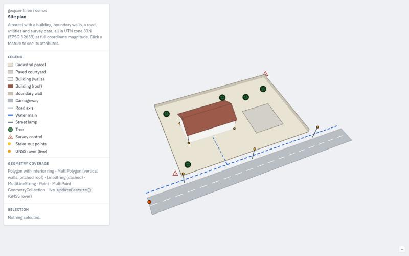

# geojson-three

GeoJSON rendering and editing for [three.js](https://threejs.org) that stays precise at real-world coordinates.

Projected and geocentric coordinates (UTM, national grids, ECEF) are too large for float32 vertex buffers:
lines jitter and small features collapse. `geojson-three` stores each feature relative to a float64 anchor,
so data renders with sub-micrometre error using stock three.js materials.

**[Demos](https://www.galfajon.dev/geojson-three/) · [Guide](https://www.galfajon.dev/geojson-three/docs/) · [API reference](https://www.galfajon.dev/geojson-three/api/)**



## Features

- All RFC 7946 geometry types, `null` geometries and 2D positions; lossless export
- Polygons with holes in any plane: horizontal, vertical walls, tilted roofs
- Batched points as outlined discs or images, sized in pixels or world units
- Per-feature styles (including [simplestyle-spec](https://github.com/mapbox/simplestyle-spec)), highlighting and raycast picking
- Editable `Point`, `Line` and `Polygon` objects with length, area and hole operations
- Measurement labels, feature events and coordinate transforms for reprojection

Requires three.js r160 or newer (tested on r187). TypeScript declarations are included.

## Installation

```bash
npm install three github:GalFajon/geojson-three
```

## Usage

```js
import { GeoJSONGroup, Polygon } from 'geojson-three';

const geo = new GeoJSONGroup(featureCollection, {
    style: (f) => ({ lineColor: f.properties.color ?? '#2563c9', fillOpacity: 0.6 }),
});
scene.add(geo);

// picking
const hit = raycaster.intersectObject(geo, true)[0];
const picked = geo.featureFromIntersection(hit);   // { key, feature, geometry? }
if (picked) geo.setHighlighted(picked.key, true);

// editable geometry
const parcel = geo.addGeometry(new Polygon([[
    [512300, 5102400, 295], [512360, 5102400, 295], [512360, 5102440, 295], [512300, 5102440, 295],
]]));
parcel.vectors[2] = [512365, 5102445, 295];
parcel.update();
parcel.calculateArea();

// export
const out = geo.toGeoJSON();
```

Projected CRSs are z-up, so set `camera.up.set(0, 0, 1)`. Lon/lat data can be reprojected through the
`transform` option (for example with proj4); it runs in float64 before anchoring.

## How it works

Each feature is a `Group` positioned at a float64 anchor, and its vertex buffers hold only small float32
offsets. three.js builds `modelViewMatrix` in float64 on the CPU, so the large translations cancel before
anything reaches the GPU. The [precision demo](https://www.galfajon.dev/geojson-three/precision/) measures
0.47 nm of vertex error at ECEF magnitude, against 111.7 mm for absolute float32 coordinates.

Keep anchored features compact (under about 10 km for sub-millimetre precision), and use
`modelViewMatrix` in custom shaders.

## Known gaps

- `geometriesFromGeoJSON` splits multi-part features and drops foreign members; use the feature API for
  lossless round trips
- Self-intersecting or otherwise invalid polygons are not validated
- No CRS detection, text labels, line arrows or WebGPU support yet

## Development

```bash
npm install
npm run dev            # demos, guide and API reference on http://localhost:5199
npm test
npm run build:types    # type-check the JSDoc and regenerate types/
```

## License

ISC
